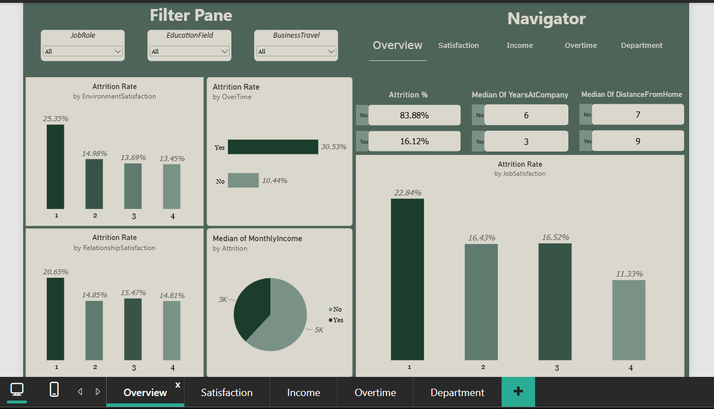
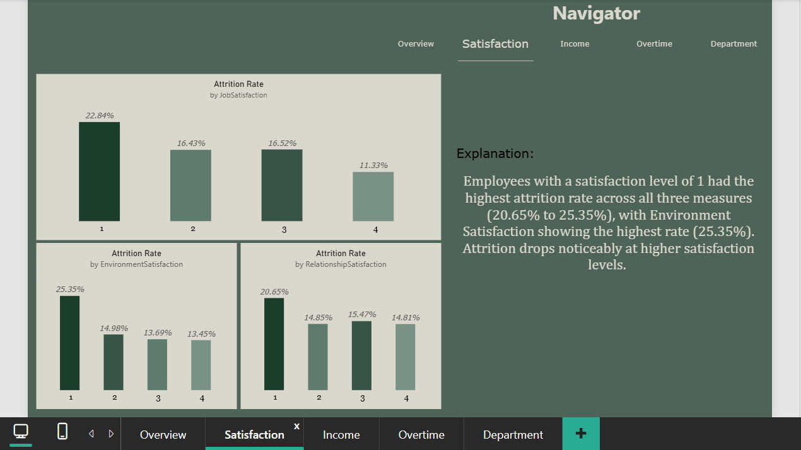
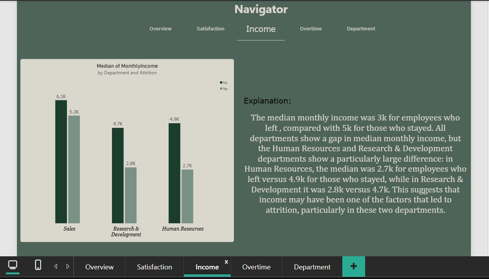
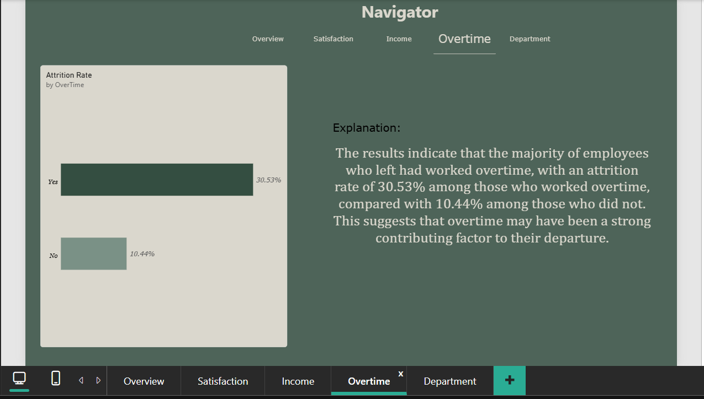
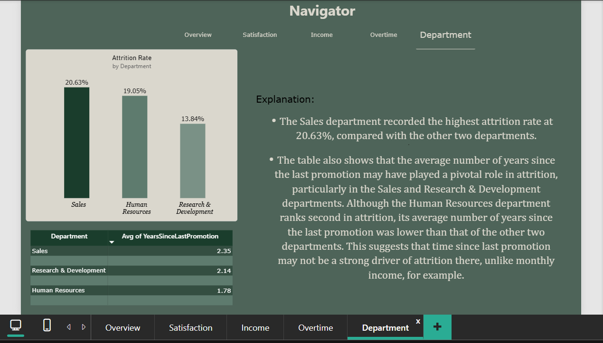

# IBM HR Attrition Analysis (Power BI)

An interactive Power BI dashboard that explores why employees leave a company, using the IBM HR Analytics dataset.

## Business Question

Which factors are most associated with employee attrition, and where should the company focus to reduce it?

## Key Findings

- **Overall attrition:** 16.12% of employees left.
- **Overtime:** employees working overtime left at **30.53%** vs **10.44%** for those who did not, about 3x higher.
- **Department:** Sales has the highest attrition rate (**20.63%**), followed by Human Resources (**19.05%**) and Research & Development (**13.84%**).
- **Satisfaction:** employees with a satisfaction level of 1 had the highest attrition in all three measures: Environment (**25.35%**), Job (**22.84%**) and Relationship (**20.65%**).
- **Income:** the median monthly income was about **3k** for employees who left vs **5k** for those who stayed. The gap is largest in Human Resources (2.7k vs 4.9k) and Research & Development (2.8k vs 4.7k).
- **Tenure:** the median time at the company was 3 years for those who left vs 6 years for those who stayed.
- **Promotion:** time since last promotion does not appear to be a consistent driver across departments.

## Dashboard Pages

| Page | What it shows |
|---|---|	
| Overview | Attrition KPIs, satisfaction and overtime snapshot, with filters (JobRole, EducationField, BusinessTravel) |
| Satisfaction | Attrition rate by Job, Environment and Relationship satisfaction |
| Income | Median monthly income of employees who left vs stayed, by department |
| Overtime | Attrition rate for overtime vs non-overtime employees |
| Department | Attrition rate by department, with years since last promotion |

## Screenshots

### Overview

### Satisfaction

### Income

### Overtime

### Department

## Method

- Cleaned and explored the data in Power BI (Power Query).
- Split the dataset into a fact table (numeric measures) and dimension tables (descriptive attributes such as department, job role, business travel, gender, marital status and education field) to build a star schema.
- Changed the values of the `Over18` column from “Y” to “Yes” for consistency with the other Yes/No columns.
- Built a DAX measure for attrition rate, calculated **within each group** (not as a share of total employees) so groups of different sizes can be compared fairly.
- Used median instead of average for income and tenure to reduce the effect of outliers.

### DAX Measures

Attrition Rate

## Tools
Power BI, DAX, Power Query

